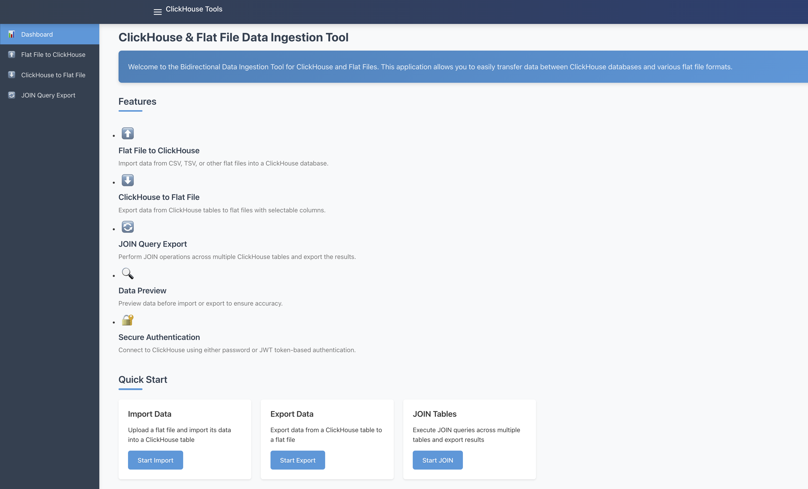

# ClickHouse Flat File Tool


> Built as a take-home assignment for Zeotap in April 2025.

A web tool for moving data between ClickHouse and flat files. A React client walks through connecting to ClickHouse (password or JWT), then importing a CSV/TSV file into a table, exporting a table (or selected columns) to a file, or joining two tables and exporting the result. A Node/Express server does the work through `@clickhouse/client`. No live demo.



## Features

- Connect to ClickHouse with a username/password or a JWT; the connect call returns a token that authorizes later API requests
- Import: upload a CSV, TSV, TXT or DAT file, detect its columns from the header, preview rows, and load it into a new or existing table (new tables use `MergeTree`)
- Export: list tables, inspect a table's schema, pick columns, preview, and download the result as a file
- Join: preview and export a JOIN across two tables
- Uploads are capped at 10 MB by default (`MAX_FILE_SIZE`)

## Tech stack

- Client: React 19, TypeScript, React Router 7, Axios, react-toastify, Vite 6, ESLint 9
- Server: Node.js, Express 5, TypeScript, `@clickhouse/client`, Multer, csv-parser, jsonwebtoken, Winston
- Optional: Docker Compose file for ClickHouse, server and client

## Getting started

Requires Node.js 20 or newer (CI runs on Node 22) and a reachable ClickHouse server (HTTP port 8123 by default).

```bash
git clone https://github.com/aayxshkumar/clickhouse-flatfile-tool.git
cd clickhouse-flatfile-tool
```

Server:

```bash
cd server
npm ci
cp .env.example .env   # then fill in the values
npm run build          # compile TypeScript to dist/
npm start              # or: npm run dev (nodemon + ts-node)
```

The API listens on `PORT` (3001 by default) under `/api`.

Client, in a second terminal:

```bash
cd client
npm ci
npm run dev            # http://localhost:5173
npm run lint
npm run build          # type-check and build into dist/
```

The client calls the API at `http://localhost:3001/api` (set in `client/src/services/apiClient.ts`).

### Environment variables (server)

All are listed in `server/.env.example`:

| Name | Purpose |
| --- | --- |
| `PORT` | API port (default 3001) |
| `NODE_ENV` | `development` or `production` |
| `CLICKHOUSE_HOST`, `CLICKHOUSE_PORT` | ClickHouse HTTP endpoint |
| `CLICKHOUSE_USER`, `CLICKHOUSE_PASSWORD`, `CLICKHOUSE_DB` | ClickHouse credentials and database |
| `JWT_SECRET`, `JWT_EXPIRES_IN` | Signing key and lifetime for generated tokens |
| `UPLOAD_TEMP_DIR` | Where uploaded and exported files are written (default `./uploads`) |
| `MAX_FILE_SIZE` | Upload limit in bytes (default 10485760) |

### Docker

`docker-compose.yml` starts ClickHouse, the API on port 3001 and the client dev server. It was not re-tested as part of this cleanup.

## Project structure

```
client/                  React app
  src/components/        connection form, file uploader, schema mapper, data preview
  src/pages/             Dashboard, ImportPage, ExportPage, JoinPage
  src/services/          API client
server/                  Express API
  src/routes/            /api/clickhouse and /api/file routes
  src/controllers/       request handlers
  src/services/          ClickHouse, file and mapping logic
  src/utils/             ClickHouse client, file parser, JWT, logger
  config.xml, users.xml  config for running a local ClickHouse from server/
docker-compose.yml
```
